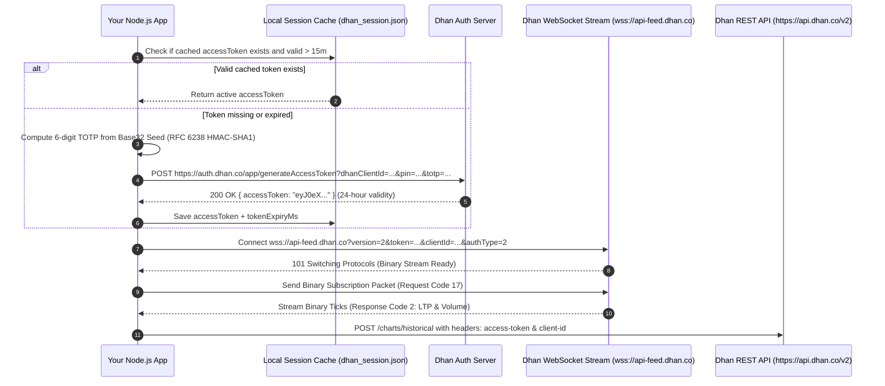

# DhanHQ v2 API & WebSocket Auto-Login Integration Guide

A complete, production-ready implementation guide and copy-pasteable module for **automated 24-hour DhanHQ API login**, RFC 6238 TOTP calculation, REST data fetching, and real-time binary WebSocket streaming.

---

## 1. Credentials & Configuration Template

Set these credentials via environment variables or a secure configuration file:

| Parameter | Environment Variable | Description |
|---|---|---|
| **Dhan Client ID** | `DHAN_CLIENT_ID` | Trading Account Client ID |
| **Dhan User PIN** | `DHAN_PIN` | 6-digit User Security PIN |
| **TOTP Secret Seed** | `DHAN_TOTP_SEED` | Base32 secret for generating RFC 6238 TOTP codes |
| **Token Auth Endpoint** | `https://auth.dhan.co/app/generateAccessToken` | Generates 24-hour JWT access token |
| **REST API Base URL** | `https://api.dhan.co/v2` | Historical OHLC candles & account endpoints |
| **WebSocket Stream URL** | `wss://api-feed.dhan.co` | High-frequency binary tick stream |

---

## 2. Architecture & Auto-Login Flow



---

## 3. Important Rules & Rate Limits

> [!WARNING]
> **Dhan 2-Minute Token Rate Limit**:
> Dhan's authentication server enforces a strict rule: **`Token can be generated once every 2 minutes`**.
> Calling `generateAccessToken` consecutively within 120 seconds will return an error. Always:
> 1. Cache the token in memory and on disk (`dhan_session.json`).
> 2. Re-authenticate only when the token is within 15 minutes of expiration, or on genuine `401 Unauthorized` responses.
> 3. Enforce a local 125-second cooldown timer before retrying forced logins.

---

## 4. Standalone Service Module (`dhan_service.js`)

Save this file as `dhan_service.js`. It uses **only standard Node.js built-ins** (`https`, `crypto`, `fs`, `path`) and `ws` for WebSocket communication (`npm i ws`).

```javascript
/**
 * Standalone DhanHQ v2 Engine: Auto-Login, REST Data API & WebSocket Stream
 */

const https = require('https');
const crypto = require('crypto');
const fs = require('fs');
const path = require('path');
const WebSocket = require('ws');

// Credentials (load from environment or secrets manager)
const DHAN_CLIENT_ID = process.env.DHAN_CLIENT_ID || 'YOUR_DHAN_CLIENT_ID';
const DHAN_PIN = process.env.DHAN_PIN || 'YOUR_DHAN_PIN';
const DHAN_TOTP_SEED = process.env.DHAN_TOTP_SEED || 'YOUR_DHAN_TOTP_SEED';

const DHAN_AUTH_URL = 'https://auth.dhan.co/app/generateAccessToken';
const DHAN_BASE_URL = 'https://api.dhan.co/v2';
const DHAN_SESSION_FILE = path.join(__dirname, 'dhan_session.json');

let dhanAccessToken = '';
let dhanTokenExpiryMs = 0;
let lastTokenGeneratedAt = 0;
const TOKEN_COOLDOWN_MS = 125 * 1000; // 2 min + 5s buffer

// Load cached session from disk on boot
try {
  if (fs.existsSync(DHAN_SESSION_FILE)) {
    const raw = JSON.parse(fs.readFileSync(DHAN_SESSION_FILE, 'utf8'));
    if (raw && raw.accessToken && raw.tokenExpiryMs && raw.tokenExpiryMs > Date.now()) {
      dhanAccessToken = raw.accessToken;
      dhanTokenExpiryMs = raw.tokenExpiryMs;
      console.log(`[Dhan] Loaded active cached session until ${new Date(dhanTokenExpiryMs).toISOString()}`);
    }
  }
} catch (e) {}

// 1. Zero-Dependency RFC 6238 TOTP Generator (HMAC-SHA1 Base32)
function getTotpCode(secret) {
  const alphabet = 'ABCDEFGHIJKLMNOPQRSTUVWXYZ234567';
  const clean = String(secret || '').toUpperCase().replace(/[\s=]/g, '');
  let bits = '';
  for (let i = 0; i < clean.length; i++) {
    const val = alphabet.indexOf(clean[i]);
    if (val < 0) throw new Error(`Invalid Base32 char: ${clean[i]}`);
    bits += val.toString(2).padStart(5, '0');
  }
  const bytes = [];
  for (let i = 0; i + 8 <= bits.length; i += 8) {
    bytes.push(parseInt(bits.slice(i, i + 8), 2));
  }
  const key = Buffer.from(bytes);
  const step = Math.floor(Date.now() / 1000 / 30);
  const counterBuf = Buffer.alloc(8);
  counterBuf.writeBigInt64BE(BigInt(step), 0);

  const hmac = crypto.createHmac('sha1', key).update(counterBuf).digest();
  const offset = hmac[hmac.length - 1] & 0x0f;
  const binary =
    ((hmac[offset] & 0x7f) << 24) |
    ((hmac[offset + 1] & 0xff) << 16) |
    ((hmac[offset + 2] & 0xff) << 8) |
    (hmac[offset + 3] & 0xff);
  return String(binary % 1000000).padStart(6, '0');
}

// 2. Auto-Login & 24h Access Token Refresh
async function getOrRefreshToken(force = false) {
  const now = Date.now();
  if (!force && dhanAccessToken && now < (dhanTokenExpiryMs - 15 * 60 * 1000)) {
    return dhanAccessToken;
  }

  // Respect Dhan 2-minute cooldown
  if (force && (now - lastTokenGeneratedAt < TOKEN_COOLDOWN_MS)) {
    console.warn('[Dhan] In 2-minute cooldown, reusing existing token');
    return dhanAccessToken;
  }

  const totp = getTotpCode(DHAN_TOTP_SEED);
  const url = `${DHAN_AUTH_URL}?dhanClientId=${DHAN_CLIENT_ID}&pin=${DHAN_PIN}&totp=${totp}`;

  const res = await new Promise((resolve, reject) => {
    const req = https.request(url, { method: 'POST', timeout: 12000 }, (r) => {
      let chunks = '';
      r.on('data', c => chunks += c);
      r.on('end', () => resolve({ statusCode: r.statusCode, body: chunks }));
    });
    req.on('error', reject);
    req.end();
  });

  if (res.statusCode === 200) {
    const parsed = JSON.parse(res.body);
    if (parsed && parsed.accessToken) {
      dhanAccessToken = parsed.accessToken;
      lastTokenGeneratedAt = Date.now();

      // Extract expiry from JWT payload
      try {
        const parts = dhanAccessToken.split('.');
        const payload = JSON.parse(Buffer.from(parts[1], 'base64').toString('utf8'));
        dhanTokenExpiryMs = (payload.exp || Math.floor(Date.now() / 1000 + 86400)) * 1000;
      } catch (e) {
        dhanTokenExpiryMs = Date.now() + 23 * 3600 * 1000;
      }

      fs.writeFileSync(DHAN_SESSION_FILE, JSON.stringify({
        accessToken: dhanAccessToken,
        tokenExpiryMs: dhanTokenExpiryMs,
        savedAt: new Date().toISOString()
      }, null, 2));

      console.log(`[Dhan] New 24h token generated! Valid until: ${new Date(dhanTokenExpiryMs).toISOString()}`);
      return dhanAccessToken;
    }
  }

  throw new Error(`Dhan auth failed: ${res.statusCode} ${res.body}`);
}

// 3. REST API Helper: Fetch Historical OHLC Candles
async function fetchHistoricalCandles({ securityId, exchangeSegment = 'NSE_EQ', instrument = 'EQUITY', fromDate, toDate }) {
  const token = await getOrRefreshToken();
  const postData = JSON.stringify({
    securityId: String(securityId),
    exchangeSegment: exchangeSegment,
    instrument: instrument,
    fromDate: fromDate, // 'YYYY-MM-DD'
    toDate: toDate
  });

  return new Promise((resolve, reject) => {
    const req = https.request(`${DHAN_BASE_URL}/charts/historical`, {
      method: 'POST',
      headers: {
        'Content-Type': 'application/json',
        'access-token': token,
        'client-id': DHAN_CLIENT_ID,
        'Content-Length': Buffer.byteLength(postData)
      },
      timeout: 10000
    }, (res) => {
      let data = '';
      res.on('data', c => data += c);
      res.on('end', () => {
        try { resolve(JSON.parse(data)); } catch (e) { reject(e); }
      });
    });
    req.on('error', reject);
    req.write(postData);
    req.end();
  });
}

// 4. WebSocket Live Stream Client
class DhanWebSocketStream {
  constructor(onTick) {
    this.ws = null;
    this.onTick = onTick; // Callback for parsed ticks
    this.subscriptions = new Set();
  }

  async connect() {
    const token = await getOrRefreshToken();
    const wsUrl = `wss://api-feed.dhan.co?version=2&token=${encodeURIComponent(token)}&clientId=${DHAN_CLIENT_ID}&authType=2`;

    this.ws = new WebSocket(wsUrl);

    this.ws.on('open', () => {
      console.log('✅ Connected to Dhan Live WebSocket Stream!');
      // Re-subscribe if reconnecting
      if (this.subscriptions.size > 0) {
        this.subscribe([...this.subscriptions]);
      }
    });

    this.ws.on('message', (buffer) => {
      if (!Buffer.isBuffer(buffer) || buffer.length < 8) return;
      const respCode = buffer.readUInt8(0);
      const secId = buffer.readInt32LE(4);

      // Response Code 2 = Ticker / Quote packet
      if (respCode === 2 && buffer.length >= 16) {
        const ltp = buffer.readFloatLE(8);
        if (this.onTick) {
          this.onTick({ securityId: secId, ltp, timestamp: Date.now() });
        }
      }
    });

    this.ws.on('close', () => {
      console.warn('⚠️ Dhan WebSocket disconnected. Auto-reconnecting in 5s...');
      setTimeout(() => this.connect(), 5000);
    });

    this.ws.on('error', (err) => console.error('Dhan WS error:', err.message));
  }

  subscribe(instruments) {
    // instruments = [{ exchangeSegment: 1, securityId: 2885 }, ...]
    if (!this.ws || this.ws.readyState !== WebSocket.OPEN) return;

    // Dhan binary subscription packet: Request Code 17
    const buf = Buffer.alloc(8 + instruments.length * 5);
    buf.writeUInt8(17, 0); // 17 = Subscribe
    buf.writeInt16LE(instruments.length, 1);

    let offset = 8;
    for (const inst of instruments) {
      buf.writeUInt8(Number(inst.exchangeSegment || 1), offset);
      buf.writeInt32LE(Number(inst.securityId), offset + 1);
      offset += 5;
      this.subscriptions.add(inst);
    }
    this.ws.send(buf);
  }
}

module.exports = {
  DHAN_CLIENT_ID,
  DHAN_PIN,
  DHAN_TOTP_SEED,
  getOrRefreshToken,
  fetchHistoricalCandles,
  DhanWebSocketStream
};
```

---

## 5. Quickstart Example (`app.js`)

```javascript
const { getOrRefreshToken, fetchHistoricalCandles, DhanWebSocketStream } = require('./dhan_service');

async function main() {
  // 1. Get or generate valid 24h JWT token
  const token = await getOrRefreshToken();
  console.log('JWT Token ready:', token.slice(0, 30) + '...');

  // 2. Fetch Historical Daily Candles for Reliance (SecID: 2885, Segment: NSE_EQ)
  const history = await fetchHistoricalCandles({
    securityId: '2885',
    exchangeSegment: 'NSE_EQ',
    instrument: 'EQUITY',
    fromDate: '2026-10-01',
    toDate: '2026-10-31'
  });
  console.log(`Received ${history.open ? history.open.length : 0} daily bars`);

  // 3. Connect real-time tick stream
  const stream = new DhanWebSocketStream((tick) => {
    console.log(`[TICK] Security: ${tick.securityId} | Price: ₹${tick.ltp.toFixed(2)}`);
  });

  await stream.connect();

  // 4. Subscribe to instruments (e.g. NIFTY 50 Index: Seg 0, SecID 13; Reliance: Seg 1, SecID 2885)
  setTimeout(() => {
    stream.subscribe([
      { exchangeSegment: 0, securityId: 13 },   // Index
      { exchangeSegment: 1, securityId: 2885 }  // Equity
    ]);
  }, 1200);
}

main().catch(console.error);
```

---

## 6. Binary Exchange Segments & Protocol Reference

When sending subscription packets via WebSocket, use these numeric Exchange Segment codes:

| Exchange Segment | Numeric Code | String Identifier |
|---|---|---|
| **NSE Index** | `0` | `IDX_I` |
| **NSE Equity** | `1` | `NSE_EQ` |
| **NSE Futures & Options** | `2` | `NSE_FNO` |
| **NSE Currency** | `3` | `NSE_CURRENCY` |
| **BSE Equity** | `4` | `BSE_EQ` |
| **MCX Commodity** | `5` | `MCX_COMM` |
| **BSE Futures & Options** | `8` | `BSE_FNO` |

---

## 7. Python Equivalent (for Python Projects)

If your other project uses Python, here is the exact equivalent using `pyotp` and `requests`:

```python
import pyotp
import requests
import json
import time

CLIENT_ID = os.getenv("DHAN_CLIENT_ID", "YOUR_DHAN_CLIENT_ID")
PIN = os.getenv("DHAN_PIN", "YOUR_DHAN_PIN")
TOTP_SEED = os.getenv("DHAN_TOTP_SEED", "YOUR_DHAN_TOTP_SEED")

def get_dhan_token():
    totp = pyotp.TOTP(TOTP_SEED).now()
    url = f"https://auth.dhan.co/app/generateAccessToken?dhanClientId={CLIENT_ID}&pin={PIN}&totp={totp}"
    
    response = requests.post(url, timeout=12)
    if response.status_code == 200:
        data = response.json()
        print("Generated Token Successfully!")
        return data.get("accessToken")
    else:
        raise Exception(f"Auth failed: {response.status_code} {response.text}")

token = get_dhan_token()
print("Token:", token[:30] + "...")
```
